# SUN-ATES entity-relationship diagram

Spec section 6 asks for a field-level ERD as an early deliverable, reviewed against the Registrar's spreadsheet
fields. This diagram is generated by hand from the migrations in `backend/database/migrations` (the source of
truth) and shows every application table, its keys and its most important columns. Framework tables (`cache`,
`jobs`, `sessions`, `failed_jobs`, `personal_access_tokens`, `password_reset_tokens`) are listed at the end.

```mermaid
erDiagram
    roles ||--o{ users : "has"
    users ||--o| alumni_profiles : "signs in as"
    schools ||--o{ departments : ""
    departments ||--o{ programmes : ""
    programmes ||--o{ alumni_profiles : "graduated from"
    alumni_profiles ||--o{ employment_records : ""
    tracer_survey_cycles ||--o{ tracer_survey_versions : "versions"
    tracer_survey_cycles ||--o{ survey_invitations : ""
    alumni_profiles ||--o{ survey_invitations : ""
    survey_invitations ||--o| survey_responses : ""
    tracer_survey_versions ||--o{ survey_responses : "answered against"
    alumni_profiles ||--o{ notification_logs : ""
    alumni_profiles ||--o{ credential_links : ""
    alumni_profiles ||--o{ followup_checks : ""
    alumni_profiles ||--o{ registration_challenges : "codes"
    users ||--o{ activity_logs : "did"
    users ||--o{ erp_sync_runs : "started"
    users ||--o{ verification_escalations : "resolved"
    schools |o--o{ job_postings : "aimed at"
    departments |o--o{ job_postings : "aimed at"
    programmes |o--o{ job_postings : "aimed at"
    schools |o--o{ event_postings : "aimed at"
    departments |o--o{ event_postings : "aimed at"
    programmes |o--o{ event_postings : "aimed at"
    programmes |o--o{ students : ""
    alumni_profiles ||--o{ mentorship_matches : "mentors"
    students ||--o{ mentorship_matches : "mentored in"

    roles { bigint id PK
        string slug "alumni | registrar | ict_admin | qa_viewer"
        string name }
    users { bigint id PK
        bigint role_id FK
        string email UK
        string password "bcrypt"
        bool is_active
        timestamp last_login_at }
    schools { bigint id PK
        string name UK }
    departments { bigint id PK
        bigint school_id FK
        string name }
    programmes { bigint id PK
        bigint department_id FK
        string name
        string code }
    alumni_profiles { bigint id PK
        bigint user_id FK "null until claimed"
        string student_number UK "Registrar-held"
        string declared_student_number "self-registered claims"
        bigint programme_id FK
        smallint graduation_year
        date graduation_date
        string class_of_award
        string first_name
        string last_name
        string email
        string phone
        string whatsapp_number
        string linkedin_url "optional, staff-only"
        string employment_status
        string further_study_status
        string record_source "registrar_import | self_registered | erp_sync"
        string verification_status "unclaimed | pending | verified | rejected"
        timestamp profile_updated_at "alumnus-confirmed freshness"
        timestamp sms_opt_out_at
        timestamp whatsapp_opt_out_at
        string unsubscribe_token UK
        timestamp ta_flagged_at
        timestamp mentor_opt_in_at
        string mentor_topics
        timestamp deleted_at "soft delete" }
    employment_records { bigint id PK
        bigint alumni_profile_id FK
        string employer
        string job_title
        string employment_type
        date start_date
        bool is_current }
    tracer_survey_cycles { bigint id PK
        int milestone_months "6 | 12 | 36"
        bigint current_version_id FK
        bool is_active }
    tracer_survey_versions { bigint id PK
        bigint tracer_survey_cycle_id FK
        int version
        json definition "immutable questionnaire" }
    survey_invitations { bigint id PK
        bigint tracer_survey_cycle_id FK
        bigint alumni_profile_id FK
        string token UK "the link credential"
        string status "scheduled | sent | completed | expired"
        timestamp due_at
        timestamp expires_at
        int reminders_sent }
    survey_responses { bigint id PK
        bigint survey_invitation_id FK
        bigint tracer_survey_version_id FK
        bigint alumni_profile_id FK
        string submission_id UK "idempotent offline retries"
        json answers
        string employment_status
        bool started_business }
    notification_logs { bigint id PK
        bigint alumni_profile_id FK
        string channel "sms | whatsapp"
        string template
        string status "queued | sent | delivered | read | failed | blocked"
        string provider_message_id
        string related_type "morph" }
    credential_verification_requests { bigint id PK
        string reference UK
        string channel "portal | api | link"
        string organisation
        string query_name
        string result "verified | not_found | ambiguous"
        bigint matched_profile_id "no FK: kept apart (spec 9)" }
    verification_escalations { bigint id PK
        string request_reference
        string requester_email
        string status
        bigint resolved_by FK }
    credential_links { bigint id PK
        bigint alumni_profile_id FK
        string token UK
        timestamp expires_at
        int views }
    erp_sync_runs { bigint id PK
        bigint started_by FK
        string driver "rest | database"
        bool dry_run
        string status
        int created
        int updated
        int rejected
        json report }
    followup_checks { bigint id PK
        bigint alumni_profile_id FK
        bigint checked_by FK
        string outcome }
    registration_challenges { bigint id PK
        string token UK
        bigint alumni_profile_id FK
        string code_hash "bcrypt"
        string channel "whatsapp | sms | email"
        text payload "encrypted: email, phone, password hash"
        tinyint attempts
        timestamp expires_at
        timestamp consumed_at }
    activity_logs { bigint id PK
        bigint user_id FK
        string action
        string subject_type
        bigint subject_id
        json changed_fields "names only, never values"
        json meta }
    job_postings { bigint id PK
        string title
        string organisation
        string type "job | internship"
        date closes_on
        bigint school_id FK
        bigint department_id FK
        bigint programme_id FK
        smallint graduation_year_from
        smallint graduation_year_to
        timestamp published_at "null = draft"
        bigint created_by FK }
    event_postings { bigint id PK
        string title
        datetime starts_at
        datetime ends_at
        string venue
        string online_url
        bigint school_id FK
        bigint department_id FK
        bigint programme_id FK
        timestamp published_at }
    students { bigint id PK
        string student_number UK
        string first_name
        string last_name
        bigint programme_id FK
        tinyint year_of_study
        timestamp contact_shared_at "consent to show mentor" }
    mentorship_matches { bigint id PK
        bigint alumni_profile_id FK
        bigint student_id FK
        string status "active | ended"
        timestamp started_at
        timestamp ended_at }
```

Renders on GitHub, in VS Code (Markdown Preview Mermaid Support) or at <https://mermaid.live>.

## Mapping to spec section 6

| Spec entity | Table(s) |
|---|---|
| AlumniProfile | `alumni_profiles` |
| School/Department, Programme | `schools`, `departments`, `programmes` |
| TracerSurveyCycle, SurveyResponse | `tracer_survey_cycles`, `tracer_survey_versions`, `survey_invitations`, `survey_responses` |
| EmploymentRecord | `employment_records` |
| CredentialVerificationRequest | `credential_verification_requests` (+ `verification_escalations`, `credential_links`) |
| EventPosting, JobPosting | `event_postings`, `job_postings` |
| MentorshipMatch | `mentorship_matches` (+ `students`, staff-managed) |
| NotificationLog | `notification_logs` |
| User, Role | `users`, `roles` |
| (added) audit trail | `activity_logs` |
| (added) registration proof | `registration_challenges` |
| (added) ERP hook, manual follow-up | `erp_sync_runs`, `followup_checks` |

Framework tables: `password_reset_tokens` (alumni password reset), `sessions` (staff console), `personal_access_tokens`
(alumni API tokens), `cache`, `cache_locks`, `jobs`, `job_batches`, `failed_jobs`.
